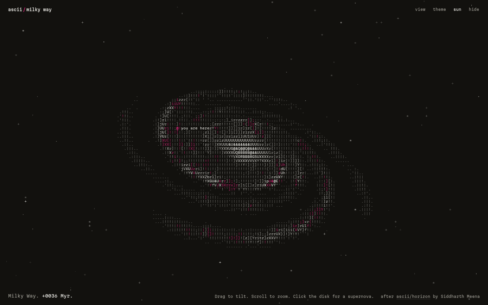

<div align="center">



# ascii / milky way

**The Milky Way, ray-marched live in the browser and typed out one letter at a time.**

Zero dependencies, no build step, plain WebGL 2 and ES modules.

Built on **[ascii/horizon](https://github.com/SiddDevZ/horizon)** by **[Siddharth Meena (SiddDevZ)](https://github.com/SiddDevZ)**. See [Credits](#credits).

</div>

## Credits

This project builds on **[ascii/horizon](https://github.com/SiddDevZ/horizon)** by **Siddharth Meena**, an ASCII black hole that bends a page of text with a real ray tracer. horizon is MIT licensed, and its copyright notice is reproduced in [LICENSE](LICENSE).

These parts are taken from horizon or adapted from it:

| Here | From horizon | What |
| --- | --- | --- |
| [`src/gl.js`](src/gl.js) | `src/gl/context.js`, `src/gl/glyphs.js` | WebGL 2 setup, the font atlas, and the glyph shape vectors: each of the 95 ASCII glyphs measured at six points |
| [`src/shaders.js`](src/shaders.js) | `src/gl/shaders/scene.frag.js`, `glyph.frag.js`, `fullscreen.vert.js` | Rendering at character-grid resolution, the six-ray shape matcher that picks the glyph, the brightness ramp fallback, and the glyph pass |
| [`src/geom.js`](src/geom.js) | `src/sim/hole.js` | The tilt and roll basis for the disk |
| [`src/main.js`](src/main.js) | `src/layout.js`, `src/ui/pointer.js`, `src/sim/tick.js` | Grid layout, drag, wheel and pinch input, and the fallback from six rays to one when frames run slow |
| [`style.css`](style.css) | `src/styles.css` | The three themes (Stage, Paper, Pink) and the interface styles |

The galaxy model is new: the volumetric ray march, the arms, bar, bulge and dust, the supernovae, the Sun marker and the starfield. The original idea of typing a physics render out as letters belongs to horizon. Go star it.

## Run it

ES modules don't load over `file://`, so serve the folder:

```bash
python3 -m http.server 4173
# or
npm run dev
```

Then open <http://localhost:4173>. To run the check: `npm test`.

## Controls

| Input | What it does |
| --- | --- |
| **Drag** | Tilt and roll the disk |
| **Scroll** / **pinch** | Zoom |
| **Click** / **tap** the disk | Set off a supernova at that spot. It turns with the galaxy |
| <kbd>1</kbd> <kbd>2</kbd> <kbd>3</kbd> | Edge on, tilted, face on (<kbd>V</kbd> cycles through them) |
| <kbd>↑</kbd> <kbd>↓</kbd> | Zoom in or out |
| <kbd>F</kbd> | A supernova somewhere along an arm |
| <kbd>Y</kbd> | Show or hide the "you are here" marker |
| <kbd>G</kbd> | Switch between shape-matched glyphs and the brightness ramp |
| <kbd>T</kbd> | Next theme |
| <kbd>Space</kbd> | Pause or play |
| <kbd>A</kbd> | Replay the intro |
| <kbd>H</kbd> / <kbd>Esc</kbd> | Hide or show the interface, for recording |

If your system asks for reduced motion, the galaxy starts fully formed and doesn't rotate.

## How it works

There are two GPU passes, and both run at the resolution of the **character grid**, not the screen (same approach as horizon).

1. **Scene pass.** For each cell, a ray leaves the camera, is clipped to a thin slab around the disk, and is marched front to back in 36 steps. At each step `galaxy()` returns three values: starlight, pink light, and dust. Light builds up and dust absorbs it (`tr *= exp(-dust * dt)`), so the dust lanes go dark and an edge-on disk gets its dark midplane. Near the galaxy, six rays per cell are matched against the ink shape of all 95 ASCII glyphs, so the edges of the arms get `/`, `(` and `_` where they belong.
2. **Glyph pass.** Each cell is drawn from the font atlas in ink or pink.

### The galaxy model

| Part | Model | Real Milky Way |
| --- | --- | --- |
| Arms | Four log spirals, pitch 14°, wound from the bar ends: Perseus and Scutum-Centaurus (major), Sagittarius and Norma (minor) | Pitch roughly 12 to 14° |
| Orion spur | A short arm segment near the Sun's radius | The Sun sits on it |
| Bar | A triaxial blob with a half-length of 0.3 disk radii | About 4.5 to 5 kpc |
| Bulge | A boxy exponential bulge | Boxy/peanut-shaped |
| Disk | Exponential in radius, Gaussian in height | |
| Dust | A thin layer, densest along the inner edge of each arm | Dust lanes trail the arms |
| HII regions | Clumpy noise on the arms, drawn in pink | Glow pink-red in H-alpha |
| Sgr A* | A bright point at the ray's closest approach to the center | |
| The Sun | `@ you are here`, 0.55 disk radii out | About 8.2 kpc from the center |
| Rotation | The arms trail. One full turn takes about 126 s, counted as 230 Myr (one galactic year) | |

This is stylized, not a survey. The shapes follow the usual picture built from Spitzer/GLIMPSE data, and the vertical scales are about twice the real ones so the dust lane still shows at grid resolution. The whole pattern rotates as one rigid body. Real stars move through the arms, because the arms are a density wave.

## Project structure

```text
index.html         markup
style.css          themes and interface (from horizon)
src/main.js        boot, render loop, input, actions
src/gl.js          WebGL 2 helpers, font atlas, glyph shapes (from horizon)
src/shaders.js     the galaxy ray march, glyph matching, glyph pass
src/geom.js        galaxy layout and camera math, shared by the CPU and the shader
src/geom.test.js   node --test: project and unproject are inverses
docs/              screenshots
```

For scripted capture, the page exposes `window.__galaxy`: `view(i)`, `supernova(x, y)`, `seek(t)`, `pause()`, `state`.

## License

[MIT](LICENSE). Includes code from [ascii/horizon](https://github.com/SiddDevZ/horizon), © 2026 Siddharth Meena, MIT.
